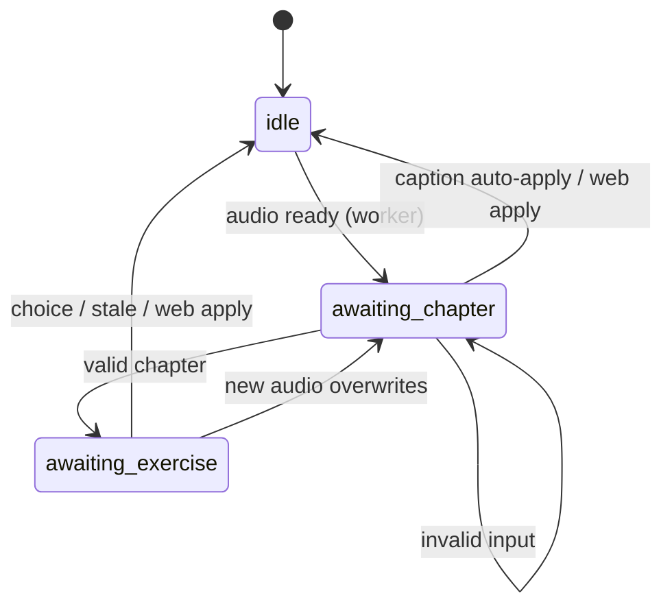
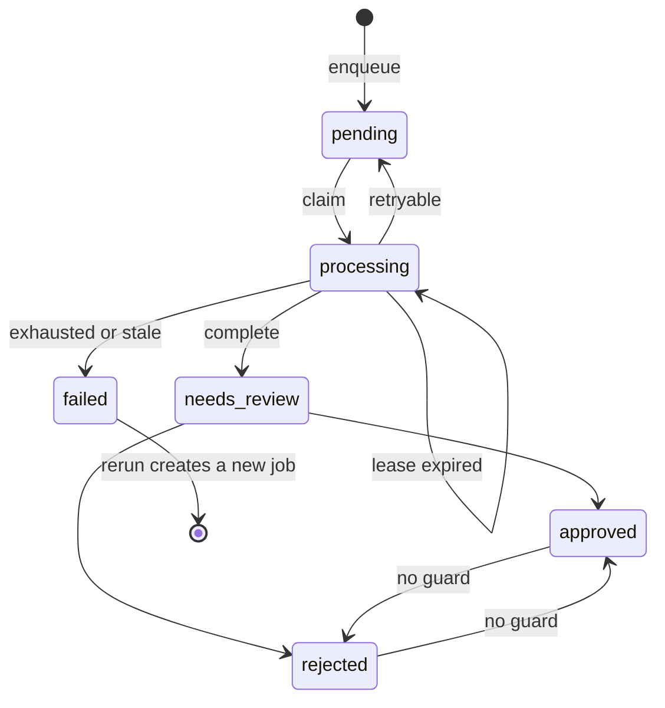
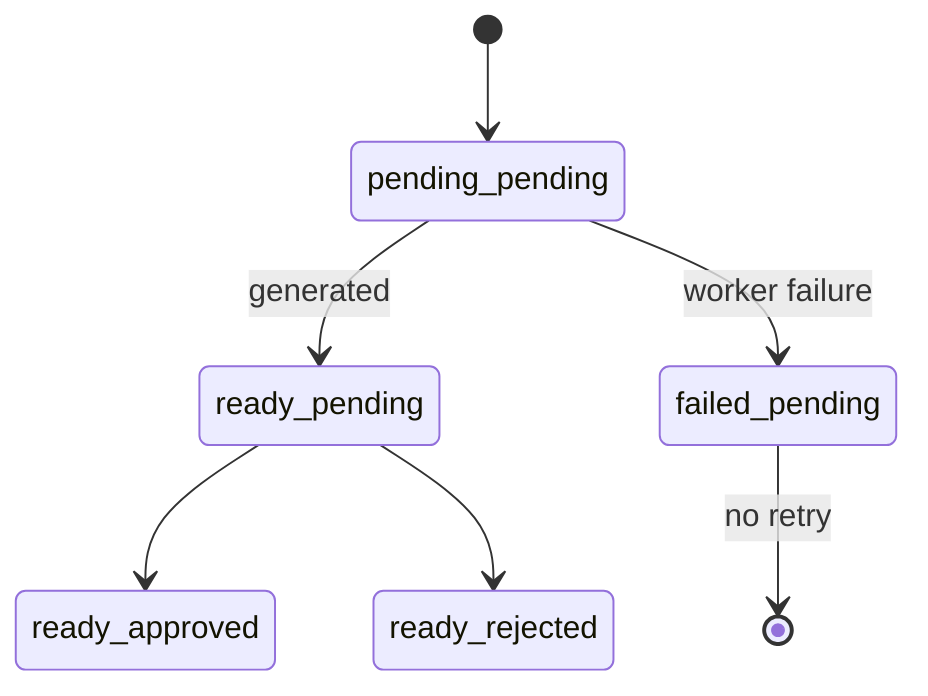
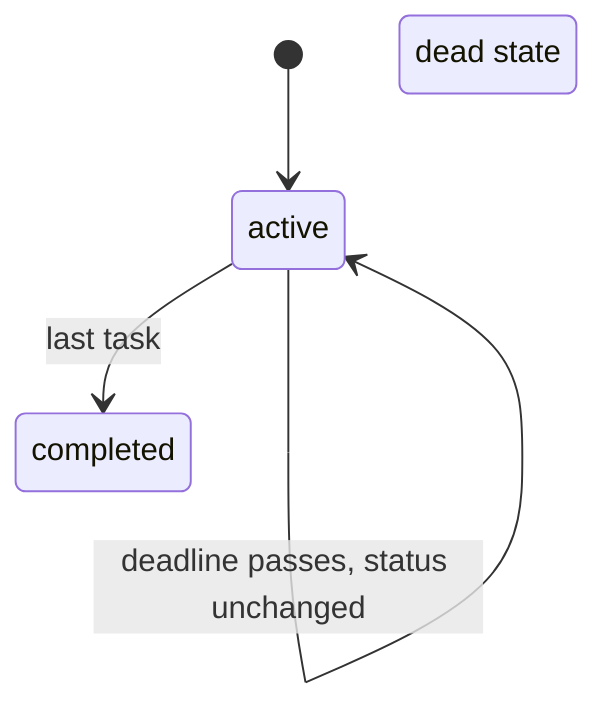
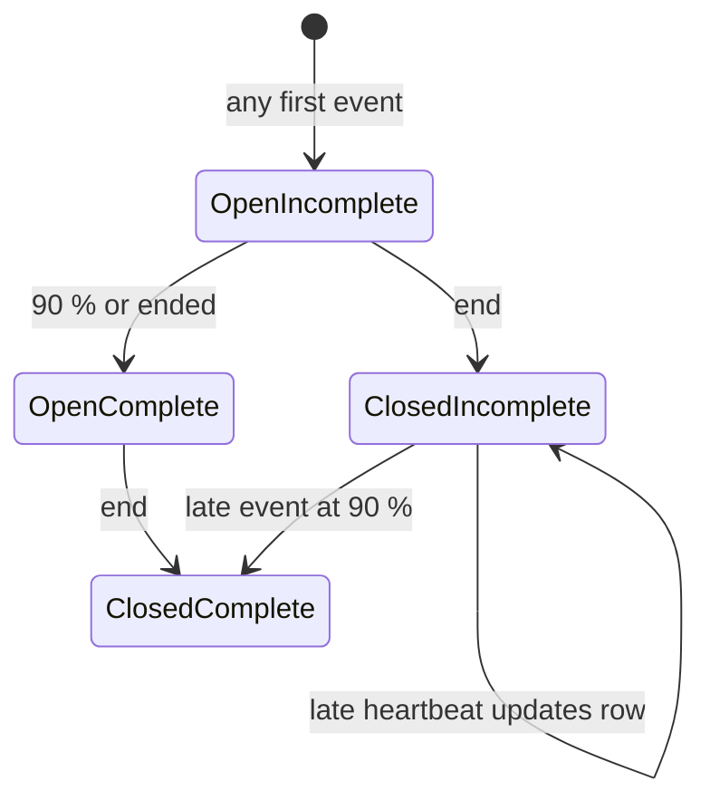
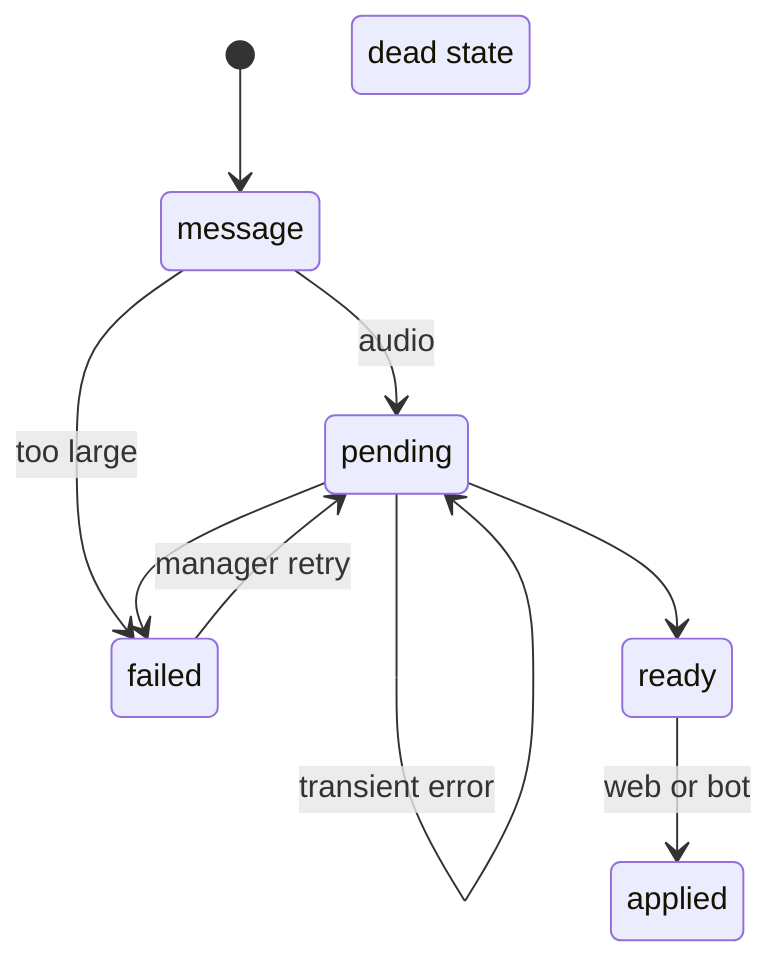
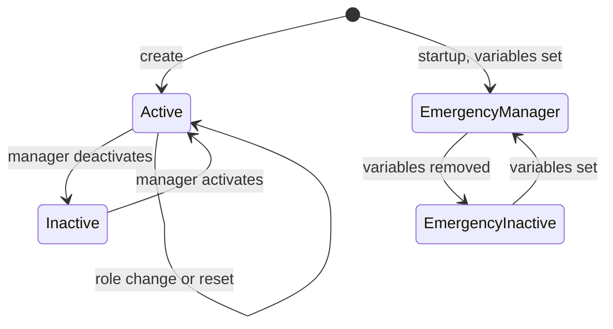
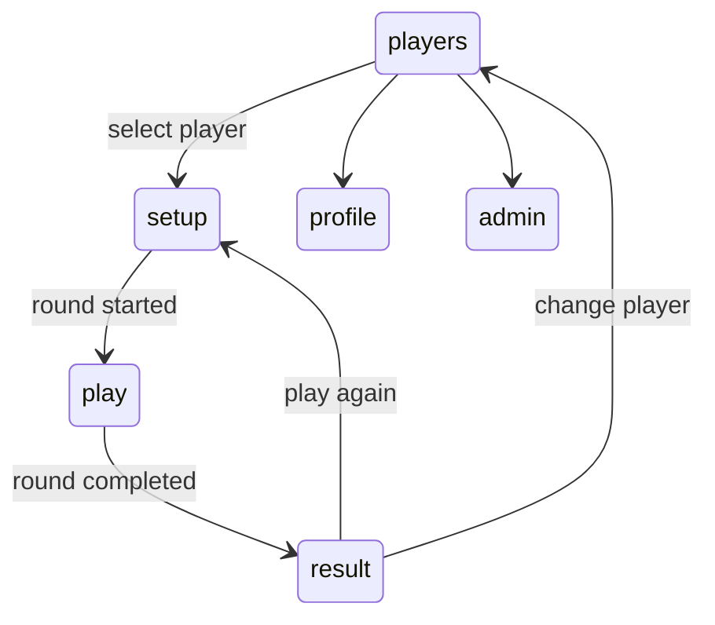
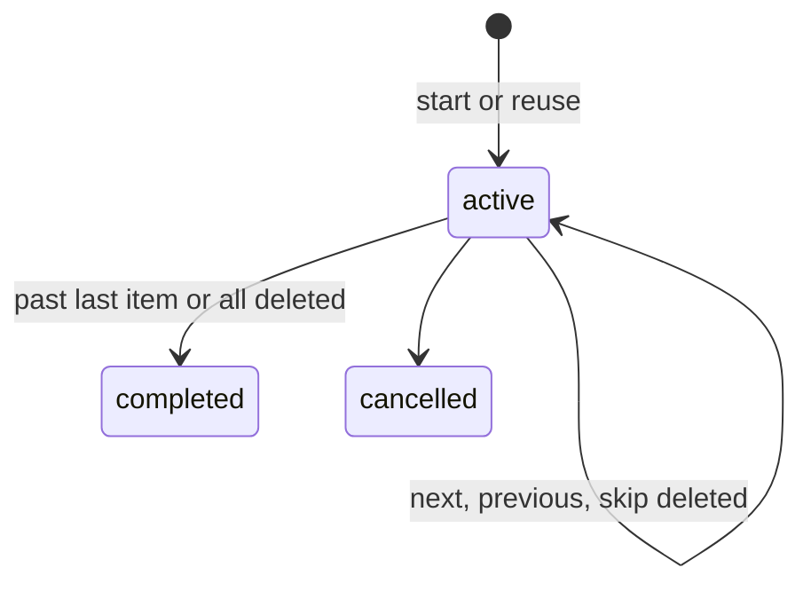

# Hidden States Audit

This document lists the implicit state machines in the application, their problems, and the refactoring priorities.

Prerequisites:
- Read `docs/developer/glossary.md` for the terms "implicit state machine" and "dead state".
- Read `docs/developer/data-model.md`.

Audit date: 2026-11-15. Commit: `15aab30`. Paths are relative to `backend/app/` unless they start with `frontend/`, `worker/`, or `docs/`.

## Summary

The audit found 15 implicit state machines. The two with the highest risk are the OMR review step and the Telegram bot conversation. Most other machines use row locks, ownership checks, and good tests. Their main weakness is states that the database accepts but no code uses, or columns without constraints on their combinations.

| # | Machine | Storage | Risk |
|---|---|---|---|
| 1 | Telegram bot conversation | `TelegramLink.conv_*` | High |
| 2 | OMR job | `OmrJob.status`, `is_current`, `locked_at` | High |
| 3 | Custom avatar | `CustomAvatar.status` × `review_status` | Medium |
| 4 | Game round and task attempt | `Round.status`, `TaskAttempt.*_at` | Medium |
| 5 | Listening session (journal) | `ListeningSession.ended_at`, `completed` | Medium |
| 6 | Telegram import | `TelegramUpdate.status` | Low to medium |
| 7 | User account | `User.role`, `is_active`, `is_emergency` | Low to medium |
| 8 | Game screen flow | `frontend/src/features/game/index.tsx` | Low |
| 9 | Listening run | `ListeningRun.status`, `current_index` | Low |
| 10 | Game season and player archive | `Season.ended_at`, `Player.archived_at` | Low |
| 11 | Telegram account link | `TelegramLinkCode` | Low |
| 12 | Telegram bot availability | `TelegramState.heartbeat_at` | Very low |
| 13 | Login session and rate limit | `LoginSession`, `LoginLimit` | Low |
| 14 | Frontend tracker and spoken player | `tracker.ts`, `player.ts` | Low |
| 15 | Exercise and frontend forms | `Exercise.deleted_at`, media IDs | Low |

## 1. Telegram bot conversation

Purpose: the bot asks the manager for a chapter and an exercise for a new audio file. The state is in 3 columns on `TelegramLink`: `conv_step`, `conv_update_id`, and `conv_chapter_id`.

States: `idle` (`conv_step` is NULL), `awaiting_chapter`, `awaiting_exercise`. There is no confirmation step.

| From | To | Trigger and guard | Location |
|---|---|---|---|
| any | `awaiting_chapter` | The worker finishes the audio conversion. The write replaces the active step. | `services/telegram.py:481` |
| `awaiting_chapter` | `awaiting_exercise` | The manager sends a valid chapter. | `services/telegram.py:175-236` |
| `awaiting_chapter` | `idle` | The caption applies the import automatically. | `services/telegram.py:221-223` |
| `awaiting_exercise` | `idle` | The manager sends a valid choice, or the target is stale. | `services/telegram.py:239-294` |
| any | `idle` | The manager applies the import in the web UI. | `services/telegram.py:566-569` |

Problems:
- Race condition. The `receive` function takes the global `linking_lock` (`services/telegram.py:312`). The worker (`:481`) and the web apply (`:566`) write the same 3 columns without that lock. A chapter reply for import A can apply to import B, or the system can lose the reply.
- Invalid combinations. The database has no constraint on the 3 columns. For example, `awaiting_exercise` with a NULL `conv_chapter_id` is possible.
- Layer inconsistency. The web UI asks for confirmation before it replaces audio (`frontend/src/features/telegram/Telegram.tsx:122-136`). The bot path replaces audio without confirmation.
- Tests. `backend/tests/test_telegram.py` covers the single-thread flow, for example `test_new_audio_while_in_conv_overwrites_state`. No test covers concurrent writers.

## 2. OMR job

Purpose: the worker recognizes the original image, and a manager approves or rejects the score.

States: `pending`, `processing`, `needs_review`, `approved`, `rejected`, `failed`. The `is_current` flag is a second dimension: current or superseded.

| From | To | Trigger and guard | Location |
|---|---|---|---|
| none | `pending` | Image upload, replacement, removal, or rerun. The code marks older jobs as not current first. | `services/omr.py:54-81`, `services/exercises.py:53-111` |
| `pending` | `processing` | The worker claims the job: retry time reached, attempts left, `SKIP LOCKED`. | `services/omr.py:85-135` |
| `processing` | `processing` | The worker claims a job with an expired lease. | `services/omr.py:98-103` |
| `processing` | `needs_review` | Completion with a matching token, a current job, and the same image. | `services/omr.py:171-213` |
| `processing` | `pending` or `failed` | Retryable error, no attempts left, stale job, or missing image. | `services/omr.py:115-128, 217-234` |
| `needs_review`, `approved`, `rejected` | `approved` or `rejected` | The manager reviews the score. | `services/omr.py:237-252` |

Problems:
- Unguarded transition. The API accepts a change from `approved` to `rejected` and back. The UI enables both buttons in all reviewable states (`frontend/src/features/omr/Review.tsx:68-77`). Each change overwrites `reviewed_by` and `reviewed_at`, so the system loses the audit trail.
- Race condition. The review locks the exercise row, not the job row, and has no version check.
- Invalid combination. The database accepts `processing` with a NULL `locked_at`. The claim query cannot recover such a row. The normal code path always sets `locked_at`.
- A superseded job can stay in `processing` until its lease expires. This has no effect, because completion checks `is_current`.
- Tests. `backend/tests/test_omr.py` covers claim, completion, lease, retry, and stale workers. No test covers a second review or concurrent reviews.

## 3. Custom avatar

Purpose: the worker generates a custom avatar, and a manager reviews it.

States: 2 columns make a 2-dimensional state. The database accepts all 9 combinations. The code reaches only 4: `pending+pending`, `failed+pending`, `ready+pending`, and `ready+approved` or `ready+rejected`.

| From | To | Trigger and guard | Location |
|---|---|---|---|
| none | `pending+pending` | The player starts a generation. | `game/services/avatars.py:94-115` |
| `pending+pending` | same | The worker claims the job with `SKIP LOCKED` and a lease. | `worker/generate_avatar.py:294-320` |
| `pending+pending` | `ready+pending` or `failed+pending` | The worker finishes or fails. | `worker/generate_avatar.py:372-387` |
| `ready+pending` | `ready+approved` or `ready+rejected` | The manager reviews. The same decision is idempotent. The opposite decision returns a conflict. | `game/services/avatars.py:267-308` |

Problems:
- Invalid combinations. The database accepts 5 combinations that the code cannot reach.
- Layer inconsistency. The API sends `failed` as `review_status: "rejected"` (`game/api/players.py:51-52`). The frontend cannot tell a manager rejection from a generation failure.
- The `failed` state has no retry. This is intentional, because each generation has a cost.
- Tests. `backend/tests/game/test_avatar_approval.py` and `test_avatar_generation.py` have very good coverage, including concurrent opposite reviews.

## 4. Game round and task attempt

Purpose: a round has 1 or more tasks. The player submits an answer for each task in order.

States: the round is `active`, `completed`, or `expired`. Each task attempt is unissued, issued, or submitted.

| From | To | Trigger and guard | Location |
|---|---|---|---|
| none | `active` | The player starts a round. The code issues task 0. | `game/services/rounds.py:128-165` |
| issued | submitted | The player submits. The code locks the round and the attempt. A replay returns the cached response. | `game/services/rounds.py:186-265` |
| unissued | issued | The code issues the next task after a submission. | `game/services/rounds.py:278-288` |
| `active` | `completed` | The player submits the last task. | `game/services/rounds.py:324-370` |

Problems:
- Dead state. No code writes `expired`. Abandoned rounds stay `active` with no time limit.
- Statistics and achievements filter on `status = 'completed'`, so the dead state does not corrupt them. But the system cannot tell an abandoned round from a round in progress.
- A replay returns the cached response before the status and expiry checks (`game/services/rounds.py:206-216`). This has no harmful effect.
- Tests. `backend/tests/game/test_round_robustness.py` covers replay and deadlines. No test covers `expired`.

## 5. Listening session (journal)

Purpose: the journal keeps 1 row for each listening session, with start, heartbeat, and end.

States: open and not complete, open and complete, closed and not complete, closed and complete. An open row with an old heartbeat is "abandoned", but the database does not store this state.

Transitions (`services/listening.py:24-106`):
- The first event of any type creates the row.
- Each event increases `max_position_sec` (never decreases it) and sets `last_heartbeat_at`.
- The `completed` flag becomes true on the `ended` event or at 90 % of the duration. It never returns to false.
- The `end` and `ended` events set `ended_at` 1 time.

Problems:
- Unguarded transition. After the code sets `ended_at`, later events still change `last_heartbeat_at`, the position, and `completed` (`services/listening.py:86-103`). A queued heartbeat can arrive after the `sendBeacon` end event. The journal then shows activity after the end of the listening session.
- Missing transition. A listening session without an end event (for example, a browser crash) stays open. No timeout closes it.
- The API checks ownership, the active run, the current exercise, and a lock for each listening session. A student cannot skip steps.
- Tests. `backend/tests/test_listening.py` has good coverage. No test covers an event after the end.

## 6. Telegram import

Purpose: the system receives an audio file from the bot, converts it, and adds it to an exercise.

States: `message`, `pending`, `ready`, `failed`, `applied`, `discarded`.

| From | To | Trigger and guard | Location |
|---|---|---|---|
| none | `message` | The webhook receives an update. A duplicate ID returns the existing row. | `services/telegram.py:308-318` |
| `message` | `pending` or `failed` | A linked manager sends audio. A file larger than 20 MB fails. | `services/telegram.py:382-403` |
| `pending` | `ready`, `pending`, or `failed` | The worker processes the file with `SKIP LOCKED` and a status check. | `services/telegram.py:409-492` |
| `failed` | `pending` | The manager retries. The code locks the row and checks `failed`. | `services/telegram.py:574-585` |
| `ready` | `applied` | The manager applies the import, or the bot applies it. The code checks `ready`. | `services/telegram.py:150-172, 527-572` |

Problems:
- Dead state. No code writes `discarded`. The frontend still shows it (`frontend/src/api/telegram.ts:13,36`).
- Missing transition. The manager cannot remove a `ready` import, so these rows collect.
- The `locked_at` column has no recovery function. Recovery uses the transaction rollback. `docs/developer/telegram-import.md:72-77` describes a different mechanism.

## 7. User account

Purpose: the account flags control access, role, and the emergency manager.

States: combinations of `role`, `is_active`, `is_emergency`, and `must_change_password`.

| From | To | Trigger and guard | Location |
|---|---|---|---|
| none | active | A manager creates the user. | `services/auth.py:295-327` |
| active | inactive, or new role | A manager edits another user. The code blocks self-changes and the emergency manager, and revokes sessions. | `services/auth.py:339-368` |
| any | password reset | A manager resets another user's password. | `services/auth.py:371-386` |
| `must_change_password` | normal | The user changes the password. | `services/auth.py:227-252` |
| any | emergency manager, or inactive | The backend starts and reads the `EMERGENCY_MANAGER_*` variables. | `services/auth.py:73-112` |

Problems:
- Race condition. The code has no check for the last manager. Managers A and B can change the role of each other at the same time. The system then has no ordinary manager.
- Invalid combination. The database accepts an emergency manager with the `student` role. The startup sync corrects it.

## 8. Game screen flow

Purpose: the frontend moves the player between the game screens (`frontend/src/features/game/index.tsx:30-155`).

Problems:
- Layer inconsistency. The `screenFromPath` function does not rebuild `/game/play/...` or `/game/result/...`. A reload or the Back button shows the player list.
- Tests. No test covers this flow.

## 9. Listening run

Purpose: a listening run keeps a queue of exercises and the position of the student.

States: `active` (1 for each student, enforced by a partial unique index), `completed`, `cancelled`. All transitions lock the row and check ownership and the `active` status (`services/listening_runs.py:56-225`).

Problem: the database checks only `current_index >= 0`. It has no upper limit. The test `test_concurrent_run_starts_create_one_saved_run` covers concurrent starts.

## 10. Game season and player archive

- Season: active while `ended_at` is NULL. A reset closes the season and creates the next season (`game/services/seasons.py:18-40`). A partial unique index and a player lock protect it. Tests cover concurrent resets.
- Player archive: `Player.archived_at` (`game/models.py:54`) is a dead state. No code reads or writes it.

## 11. Telegram account link

Purpose: a manager creates a one-time code to link a Telegram account.

States: no code, usable code, expired code, linked. All writes use the advisory lock (`services/telegram.py:81-111, 323-365`). The code checks the expiry only when the bot receives the code. No job removes old codes.

## 12. Telegram bot availability

The API calculates `available` from the age of `heartbeat_at` (`api/telegram.py:60-67`). The state has no stored value, so it has no transition problems.

## 13. Login session and rate limit

A session is valid, extends on each request, and expires or is revoked. A rate-limit bucket reaches the limit and expires after its time window. The writes use sorted advisory locks (`services/auth.py:136-224`). Authentication rejects inactive users.

## 14. Frontend tracker and spoken player

- Tracker (`frontend/src/features/listening/tracker.ts:13-107`): no attempt, playing, paused, finished, or end beacon. Tests cover pause, resume, threshold, and the beacon.
- Spoken player (`frontend/src/features/spoken/player.ts:145-297`): idle, loading, playing, idle. A generation counter stops late results. Tests cover stop during load and late decode.

## 15. Exercise and frontend forms

- Exercise: image only, audio only, or both. A database constraint requires 1 or more media files, also for deleted rows. Soft delete has no restore (`services/exercises.py:56-153`).
- Forms (`Exercises.tsx`, `Users.tsx`, `AuthArea.tsx`): closed, editing, saving, then closed or editing on error. React Query mutation flags control the state. Tests cover these flows.

## Problems by category

| Category | Findings |
|---|---|
| Invalid combinations | Custom avatar (5 of 9 cannot occur). OMR `processing` without a lock. Telegram conversation columns. Emergency manager with the `student` role. No upper limit on `current_index`. |
| Dead states | `Round.expired`, `TelegramUpdate.discarded`, `Player.archived_at`. |
| Missing transitions | Abandoned listening sessions stay open. Active rounds do not expire. The manager cannot remove `ready` imports. No exercise restore (possibly intentional). |
| Unguarded transitions | OMR `approved` to `rejected` and back. Journal events after the end. |
| Race conditions | Telegram conversation (3 writers, 1 lock). OMR review (no job lock). Last manager. |
| Layer inconsistencies | Avatar `failed` sent as `rejected`. Audio replacement confirmation only in the web UI. The frontend handles `discarded`, which no code writes. Game play and result URLs do not reload. |
| Transitions without tests | OMR second review. Concurrent Telegram conversation writes. Journal event after the end. Round expiry. Game screen flow. Last manager. |

## Refactoring priorities

Use 1 pattern in the backend: a `StrEnum`, a `TRANSITIONS: dict[S, set[S]]` table, and 1 `transition()` function with a conditional `UPDATE ... WHERE status = :from`. This pattern agrees with the Postgres queue and `SKIP LOCKED`. It needs no new dependency. XState is not necessary for the frontend flows.

| Priority | Machine | Recommendation | Reason |
|---|---|---|---|
| 1 | Telegram bot conversation | Make a `ConvStep` enum and 1 `advance(link, event)` function. Take `linking_lock` or `SELECT ... FOR UPDATE` on the link in all 3 writers. Add a `CHECK` for the 3 columns. | This is the only confirmed race condition. It can attach audio to the wrong exercise. |
| 2 | OMR job | Make an enum and a transition table with conditional updates. Decide if a manager can change a review. If yes, record each change. If no, accept a review only from `needs_review`. | Students see the score only after approval, so this state controls visible content. |
| 3 | Custom avatar | Replace the 2 columns with 1 enum: `queued`, `generating`, `failed`, `awaiting_review`, `approved`, `rejected`. Send `failed` as `failed`. | This removes 5 impossible states and the frontend confusion. |
| 4 | Game round | Write `expired` (lazily or with a sweep), or remove it from the `CHECK`. Add a `RoundStatus` enum. | The logic is correct, but the schema does not agree with the code. |
| 5 | Listening session | Do not change position or heartbeat after `ended_at`. Add a cutoff for abandoned listening sessions in the journal. Add 1 test. | A small fix is sufficient. A full refactor is not necessary. |
| 6 | Telegram import | Add an enum and a transition table. Add a `discard` action, or remove `discarded` from the database and the frontend. | This removes a dead state. |
| 7 | User account | Lock all managers and count them before a demotion or deactivation. | A small guard is sufficient. |
| 8 | Game screen flow | Use a discriminated union `Screen` with a `useReducer` and parse all paths. | This makes reload and Back work. |
| 9 to 15 | Other machines | Keep them as they are. | Locks, tests, or simple React Query flows already protect them. |

Before you start a refactor, read `docs/DECISIONS.md`. Some dead states can be the result of a past decision.
